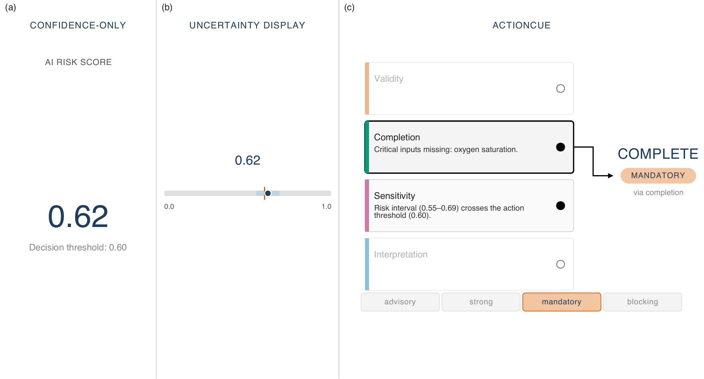

# ActionCue: Uncertainty-to-action binding

ActionCue is a research prototype for making explicit how multiple uncertainty conditions compose into a single human-oversight response. It accompanies *Visualizing Uncertainty-to-Action Composition for Human Oversight* by Chisom Anyabolu, Akshat Dubey, and Georges Hattab (2026).

**[Paper (arXiv:2608.16428)](https://arxiv.org/abs/2608.16428)** · **[PDF](https://arxiv.org/pdf/2608.16428)** · **[Live demo](https://actioncue.streamlit.app/)**

## Prototype preview



Static preview of Case C, rendered by the [existing prototype components](viz/composite.py). Completion wins precedence over sensitivity, while sensitivity remains visible as a supporting condition. The image shows the prototype's rendered panels; the live demo adds interactive inspection.

## Research question and method

How can an interface show which oversight response follows when several uncertainty conditions occur together, and make the composition of that response inspectable?

The prototype binds uncertainty conditions to an action, a workflow force, a responsible actor, and a rationale. Four rule classes compose in this precedence order: **validity → completion → sensitivity → interpretation**. The highest-precedence firing determines the primary cue; other firings remain as supporting cues. If no rule fires, the result is **proceed / advisory**. For a cue produced by a fired rule, high harm **or** low reversibility raises the workflow force by one level, preserving the action. A constraint matrix checks permitted action–force combinations.

ActionCue displays the case input, detected signals, and annotated composition cascade. A three-way comparison places that trace alongside confidence-only and data-level uncertainty displays for the same case.

**The oversight response concerns whether and how the AI-supported decision path may proceed.** For example, `complete / mandatory` in Case C asks the clinician to obtain missing oxygen saturation before proceeding; it does not prescribe a diagnosis or treatment. Likewise, credit and disaster cues do not decide loan approval or evacuation. The prototype visualizes workflow force; it does not execute or enforce a domain workflow.


## Installation and running

Use Python 3.11+; the repository's [development container](.devcontainer/devcontainer.json) uses Python 3.11. Clone the repository and create a virtual environment:

```bash
git clone https://github.com/Sombiri/actioncue.git
cd actioncue
python3 -m venv .venv
source .venv/bin/activate
python -m pip install -r requirements.txt
```

On Windows PowerShell, activate with `.venv\Scripts\Activate.ps1` instead of the `source` command. Run the remaining commands from the repository root with the environment activated.

The declared dependencies are listed in [requirements.txt](requirements.txt):

| Dependency | Declared requirement | Purpose |
|------------|----------------------|---------|
| Streamlit | `streamlit>=1.30` | Interactive prototype |
| pytest | `pytest>=7.0` | Engine tests |
| CairoSVG | `cairosvg` (no version bound) | Static figure export |

The cases and rule engine run locally without external datasets, API credentials, or model downloads. Installing dependencies requires access to the package sources; the hosted demo requires an internet connection.

### Run locally

```bash
python -m streamlit run app.py
```

Open [http://localhost:8501](http://localhost:8501). The sidebar offers two view modes and seven cases; **C** is selected by default:

- **ActionCue (full):** case input and signals above the composition cascade. Hover the resolution and safety arrows for tooltips; click a fired band to inspect its rationale and triggering signal.
- **Three-way comparison:** confidence-only, uncertainty display only, and the ActionCue cascade. In Case C, the score (0.62) exceeds the threshold (0.60), but the interval (0.55–0.69) crosses it and oxygen saturation is missing. ActionCue makes completion the primary oversight response and retains sensitivity as supporting context.

The **Rules registry** expander shows the same four rule definitions used by the engine, including their precedence, class, base action, base force, signal, and description.

### Run the existing tests

```bash
python -m pytest tests/
```

The suite contains 11 tests: seven case behaviors plus checks for permitted action–force combinations, rejection of invalid combinations, rejection of within-class plurality, and attachment of triggering signals.


## Demonstarted cases

Cases are Python objects in [cases/healthcare.py](cases/healthcare.py) (`CASE_A`–`CASE_E`) and [cases/cross_domain.py](cases/cross_domain.py) (`CASE_CR`, `CASE_DR`). No external data files are read.

| Case | Domain | Implemented oversight response |
|------|--------|--------------------------------|
| `CASE_A` | Healthcare | No rules fire → **proceed / advisory**. |
| `CASE_B` | Healthcare | Sensitivity fires → **inspect / strong**. |
| `CASE_C` | Healthcare | Completion wins precedence over sensitivity → **complete / mandatory**. |
| `CASE_D` | Healthcare | Validity wins precedence over sensitivity → **escalate / mandatory**. |
| `CASE_E` | Healthcare | Validity wins; high harm and low reversibility raise force → **escalate / blocking**. |
| `CASE_CR` | Credit risk | Validity dominates completion and sensitivity → **escalate / mandatory**. |
| `CASE_DR` | Disaster forecasting | Sensitivity dominates interpretation; the safety modifier raises force → **inspect / mandatory**. |

The safety modifier raises force without changing the action: Case E remains **escalate**, with **blocking** force.

## Repository map

| Location | Description |
|----------|-------------|
| [models.py](models.py) | Dataclasses for cases, rules, signals, firings, and cues. |
| [rules.py](rules.py) | Four rule definitions and the signal resolver. |
| [engine.py](engine.py) | Rule firing, precedence, safety modifier, and action–force validation. |
| [cases/](cases/) | Seven synthetic worked cases. |
| [viz/](viz/) | SVG renderers, styles, interaction script, and figure compositors. |
| [ui/](ui/) | Streamlit display wrappers and comparison layout. |
| [app.py](app.py) | Streamlit entry point, case selection, and view modes. |
| [export_figures.py](export_figures.py) | Static figure export. |
| [tests/test_engine.py](tests/test_engine.py) | Existing engine tests. |

## Citation

If you use or build on this work, please cite the [arXiv preprint](https://arxiv.org/abs/2608.16428):

```bibtex
@misc{anyabolu2026actioncue,
  title         = {Visualizing Uncertainty-to-Action Composition for Human Oversight},
  author        = {Anyabolu, Chisom and Dubey, Akshat and Hattab, Georges},
  year          = {2026},
  eprint        = {2608.16428},
  archivePrefix = {arXiv},
  primaryClass  = {cs.HC},
  doi           = {10.48550/arXiv.2608.16428},
  url           = {https://arxiv.org/abs/2608.16428}
}
```

## License

Released under the MIT License — see [LICENSE](LICENSE).
